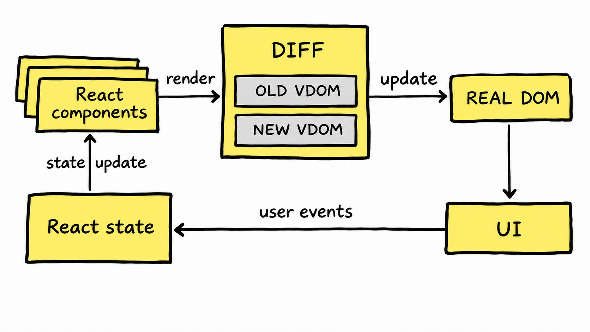
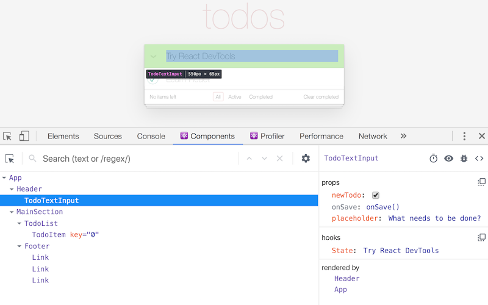

<!-- prettier-ignore -->
---
title: Advanced React
ᴴₒᴴₒᴴₒ: true
---


# Advanced React

This workshop moves from the React concepts that describe a screen to the patterns used in a production application.

## Prerequisites

- Basic knowledge of HTML, CSS and JavaScript.
- Familiarity with modern JavaScript syntax (ES6+).
- Basic understanding of APIs and asynchronous programming.

---

## What is React?

React is a **JavaScript library** for building user interfaces. It is not a programming language, and React alone does not prescribe every part of an application in the way a full framework does.

React lets us describe what the UI should look like for the current data. When that data changes, React updates the relevant parts of the page.

### JSX

JSX is a syntax extension that lets us describe UI with JavaScript-like markup:

```tsx
function Greeting() {
  return <h1>Hello!</h1>;
}
```

Browsers do not run JSX directly. A build tool transforms it into JavaScript that creates React elements.

### DOM and React DOM

The **DOM** is the browser's in-memory representation of a web page. **React DOM** is the package that renders React components into that browser DOM.

---

## How React updates the UI



1. Components describe the next UI.
2. React compares the new virtual DOM with the previous virtual DOM. This comparison is called **reconciliation**.
3. React DOM commits only the required changes to the browser DOM.
4. The browser paints the visible UI.
5. A user event can update React state, which starts the cycle again.

React's virtual DOM is a JavaScript representation of the UI, not a second browser DOM.

---

## Components, props, and composition

Components are reusable functions that return UI. Props are inputs passed into those components. Composition combines small components into a page.

```tsx
type CandidateCardProps = {
  name: string;
  onSelect: () => void;
};

function CandidateCard({ name, onSelect }: CandidateCardProps) {
  return <button onClick={onSelect}>{name}</button>;
}

function CandidateList() {
  return (
    <section>
      <h2>President candidates</h2>
      <CandidateCard name="Alex" onSelect={() => {}} />
      <CandidateCard name="Sam" onSelect={() => {}} />
    </section>
  );
}
```

This keeps the page readable, makes behaviour easier to test, and lets the same component be reused with different data.

### Component lifecycle and re-rendering

A component's **lifecycle** is its complete time in an application: mount, render, effects, and unmount.

A **re-render** is one new render during that lifecycle. It is commonly triggered by changed state, props, or context. React then updates the browser DOM only where it needs to.

### Dev tool

??? info "[React Developer Tools](https://chromewebstore.google.com/detail/react-developer-tools/fmkadmapgofadopljbjfkapdkoienihi)"
    


---

## State and events

State stores data that can change over time and affects what appears on screen. An event handler updates the state; React then re-renders the component.

```tsx
import { useState } from "react";

export function Welcome() {
  const [name, setName] = useState("Jack");

  return (
    <section>
      <label htmlFor="name">Your name</label>
      <input
        id="name"
        value={name}
        onChange={(event) => setName(event.target.value)}
      />
      <p>Welcome, {name}</p>
    </section>
  );
}
```

The flow is:

1. The user types a name.
2. The event handler calls `setName`.
3. React schedules a re-render with the new state.
4. React DOM updates the affected browser DOM.
5. The browser paints the new screen.

---

## React hooks

Hooks let function components use React features such as state, context, refs, effects, and memoisation.

### State hook: `useState`

`useState` stores a value that affects the UI. The setter updates that value and schedules a re-render.

```tsx
const [selectedCandidate, setSelectedCandidate] = useState<string | null>(null);
```

Use state for data the user should see change on screen.

### Context hook: `useContext`

`useContext` reads shared data without passing it through every intermediate component as props.

```tsx
const member = useContext(MemberContext);
```

Good context candidates include the signed-in member, theme, locale, and app-level settings. Use ordinary props for data that is only needed by nearby components.

### Ref hook: `useRef`

`useRef` keeps a value between renders without re-rendering the component when that value changes.

```tsx
const inputRef = useRef<HTMLInputElement>(null)

<input ref={inputRef} />
```

Refs are useful for accessing a DOM element or storing an instance value such as a timer ID. Changing `ref.current` does not update the screen.

### Effect hook: `useEffect`

`useEffect` synchronises a component with something outside React, such as a browser API, network subscription, or timer.

```tsx
useEffect(() => {
  document.title = `Selected: ${selectedCandidate ?? "none"}`;
}, [selectedCandidate]);
```

Do not use an effect only to calculate UI from state you already have; derive that value during rendering instead.

### Performance hook: `useMemo`

`useMemo` caches an expensive calculation until its inputs change.

```tsx
const visibleCandidates = useMemo(
  () => candidates.filter((candidate) => candidate.isEligible),
  [candidates],
);
```

Measure first. `useMemo` is a performance tool, not a default habit.


??? info "References"
    [Built-in React Hooks](https://react.dev/reference/react/hooks)

---

## What do we need for a real project?

React is the UI library. A real application also needs conventions, styling, type safety, UI components, and a reliable way to manage server data.

| Technology     | Purpose                                       |
| -------------- | --------------------------------------------- |
| Next.js        | Application framework and routing             |
| TypeScript     | Type safety                                   |
| Tailwind CSS   | Styling and responsive design                 |
| shadcn/ui      | Reusable UI components                        |
| Axios          | API requests                                  |
| TanStack Query | Server state management, caching and fetching |


---

## Next.js: React for production applications

Next.js is a widely used full-stack React framework. It provides file-based routing, rendering options, server-side code, and conventions for building complete web applications.

### Pages Router and App Router

| Behaviour                                       | Pages Router (`pages/`)                                                   | App Router (`app/`)                                                                                                 |
| ----------------------------------------------- | ------------------------------------------------------------------------- | ------------------------------------------------------------------------------------------------------------------- |
| Initial HTML generation                         | Server, at build time or request time                                     | Server, at build time or request time                                                                               |
| Browser hydration                               | Every component on the page ships JavaScript and hydrates in the browser. | Only components marked with `"use client"` ship JavaScript and hydrate. Server Components never run in the browser. |
| Can you use `useState` or `useEffect` anywhere? | Yes: page components render for initial HTML and hydrate in the browser.  | No: only Client Components marked with `"use client"` can use client-only hooks.                                    |

In the App Router, start with Server Components. Add `"use client"` only when a component needs browser-only behaviour, such as state, effects, event handlers, or browser APIs.

??? info "References"
    [Next.js App Router](https://nextjs.org/docs/app/getting-started)

    [Next.js Page Router](https://nextjs.org/docs/pages/getting-started)


---

## Demo

View [demo code](https://github.com/codersforcauses/django-nextjs-template/pull/57)

In the demo project, explore how the pieces work together:

1. Route to a page with the Next.js App Router.
2. Render CandidateCard components with TypeScript props.
3. Select a candidate with `useState`.
4. Fetch server data with Axios and TanStack Query.
5. Build the interface with Tailwind CSS and shadcn/ui components.


---

## Key takeaways

- Understand how React works and interacts with the browser DOM.
- Understand how React renders and re-renders the UI in response to state changes.
- Understand component composition, lifecycle and commonly used React hooks.
- Understand Next.js, including routing, Server Components and Client Components.
- Navigate and understand a real-world React project structure.
- Understand how different technologies work together in a modern React application.

